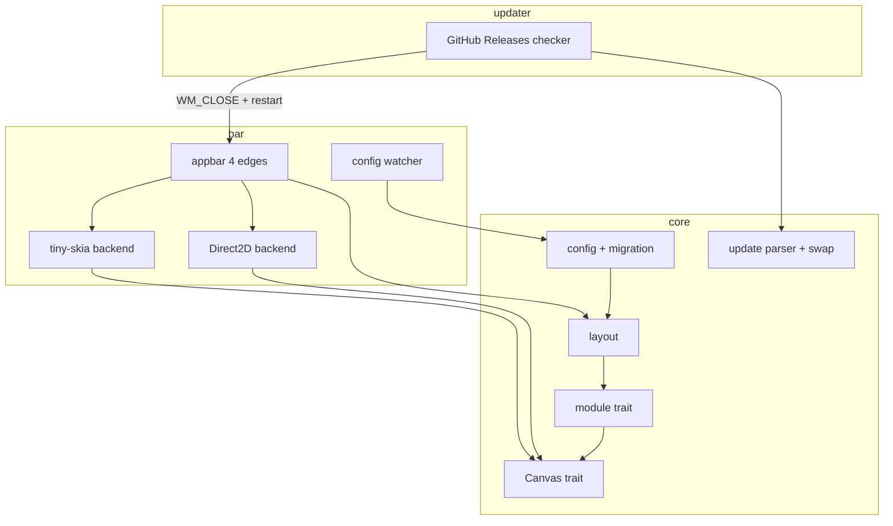

# Taskbar Foundation Implementation Plan

> **For agentic workers:** REQUIRED SUB-SKILL: Use superpowers:subagent-driven-development (recommended) or superpowers:executing-plans to implement this plan task-by-task. Steps use checkbox (`- [ ]`) syntax for tracking.

**Goal:** Cargo workspace with a platform-independent `core` crate (versioned config with migration, edge-aware layout, module/canvas traits, and GitHub release version/swap logic), a `bar` crate that shows a configurable four-edge appbar with live config reload and two measured render backends, and a separate `updater` crate that checks `merterdem13/Taskbar` GitHub Releases and updates binaries without touching user customizations.

**Architecture:** `core` holds everything testable without Windows (config schema + migration, layout with vertical cross-axis clamping, module/canvas traits, and GitHub release parsing + safe binary swap). `bar` is the Win32 shell: single-registration appbar placement across four edges, config file watching, right-click menu, and rendering through a `Canvas` trait with two interchangeable backends (Direct2D, tiny-skia). `updater` is a standalone helper binary (`taskbar-updater.exe`) so `bar` carries zero network/HTTP bloat; it checks GitHub Releases, tells `bar` to cleanly unregister and exit via `WM_CLOSE`, swaps the `.exe` files, and restarts `bar` while leaving `%APPDATA%\Taskbar\config.toml` untouched.

**Tech Stack:** Rust (edition 2024), `windows` 0.62, `serde` + `toml` + `serde_json`, `tiny-skia`, `fontdue`, `ureq` (in `crates/updater` only).

**Spec:** [2026-11-15-taskbar-architecture-design.md](file:///C:/Users/Mert/Documents/Taskbar/docs/superpowers/specs/2026-11-15-taskbar-architecture-design.md)

**Out of this plan (separate plans, in this order):** (2) named-pipe live preview + Tauri settings app, (3) port battery readers (Razer/SteelSeries HID, Bluetooth) as a module.

## Global Constraints

- Repository is `https://github.com/merterdem13/Taskbar` (completely independent of `TaskbarBatteryWidget`).
- Windows 10/11 only; Windows 11 gets acrylic/mica, Windows 10 falls back to a plain translucent/solid background.
- Bar idle CPU ≈ 0: no polling loops; redraw only on events (power change, minute tick, time change, config change).
- Bar has zero network/HTTP dependencies; update checking and downloading live exclusively in `crates/updater`.
- Memory target 10–20 MB; above 30 MB must be justified in the decision record.
- Visual baseline is fixed and not traded for memory: acrylic/mica backdrop, anti-aliased rounded corners, crisp text, smooth DWM animation.
- Config lives at `%APPDATA%\Taskbar\config.toml`, schema carries a `version` field; edges: `top | bottom | left | right`.
- Updates and installations NEVER overwrite or delete `%APPDATA%\Taskbar\config.toml`; user customizations (e.g., `edge = "right"`, custom colors, module order) survive every update.
- Windows' own taskbar and `explorer.exe` are never modified.
- Theme values (colors, font, sizes) are data in config, not hard-coded.

## Review Focus

- `config.toml` missing, empty, or syntactically broken at startup → bar starts with defaults, never crashes or shows nothing.
- Config becomes broken while the bar runs → keep the last good config, no flicker.
- Older config (`version = 0` or partial v1 file with user-customized `edge = "right"`) → migrated to current `CONFIG_VERSION` with all user-customized fields preserved; unknown/newer `version` → ignore file, use defaults, log a message.
- Zero/negative/huge `thickness` or module sizes → clamped to sane limits, no panic.
- Vertical edges (`Left`/`Right`) with narrow `thickness` (e.g. 40 px) → modules format text compactly across two lines and `layout_modules` clamps cross-axis width to fit inside the bar instead of dropping or overflowing horizontally.
- Modules exceeding main-axis bar length → dropped from the end (`w == 0 && h == 0`), never overlapping.
- Resolution/DPI change, monitor unplug, or other appbar move (`ABN_POSCHANGED`) while running → appbar updates position (`ABM_QUERYPOS`/`ABM_SETPOS` without duplicate `ABM_NEW`) and fits the new screen.
- Process killed/crashes or receives `WM_CLOSE` from updater → desktop work area recovers (`ABM_REMOVE` called on `WM_DESTROY` and panic hook).

---

### Task 1: Workspace and config schema with migration

**Files:**
- Create: `Cargo.toml` (workspace), `crates/core/Cargo.toml`, `crates/core/src/lib.rs`, `crates/core/src/config.rs`
- Move: `src/main.rs` → `crates/bar/src/main.rs` (prototype kept until Task 4/6 replace it), `Cargo.toml` package → `crates/bar/Cargo.toml`
- Test: `crates/core/src/config.rs` (`#[cfg(test)]`)

**Interfaces:**
- Produces:
  - `pub enum Edge { Top, Bottom, Left, Right }` (serde lowercase, ` Edge::is_vertical(self) -> bool`)
  - `pub enum Align { Start, Center, End }`
  - `pub enum Backdrop { Acrylic, Mica, Solid }`
  - `pub struct Config { pub version: u32, pub bar: BarConfig, pub theme: Theme, pub modules: Vec<String> }`
  - `pub struct BarConfig { pub edge: Edge, pub align: Align, pub thickness: u32, pub gap: u32, pub corner_radius: u32, pub backdrop: Backdrop }`
  - `pub struct Theme { pub foreground: [u8; 4], pub pill: [u8; 4], pub font: String, pub font_size: f32 }`
  - `pub const CONFIG_VERSION: u32 = 1;`
  - `impl Default for Config` (edge top, thickness 40, align center, gap 8, corner_radius 12, backdrop acrylic, modules `["battery","clock"]`)
  - `Config::parse(text: &str) -> Result<Config, ConfigError>` (accepts `version <= CONFIG_VERSION`, upgrades `version` to `CONFIG_VERSION` while keeping all user-specified fields such as `bar.edge = Right`)
  - `Config::clamped(self) -> Config` (thickness 24..=120, gap ≤ 64, radius ≤ 40, font_size 8.0..=32.0)
  - `pub enum ConfigError { Syntax(String), UnsupportedVersion(u32) }`

- [ ] **Step 1: Write failing tests** in `crates/core/src/config.rs`:
  - `parses_full_config` (all fields round-trip)
  - `missing_fields_use_defaults` (`parse("version = 1")` equals `Config::default()`)
  - `empty_text_is_default_error_free` (`parse("")` → defaults)
  - `preserves_user_customization_on_partial_or_older_version` (`parse("version = 0\n[bar]\nedge = \"right\"\nthickness = 48")` → `cfg.version == 1`, `cfg.bar.edge == Edge::Right`, `cfg.bar.thickness == 48`, other fields default)
  - `broken_toml_is_syntax_error`
  - `future_version_rejected` (`version = 99` → `UnsupportedVersion(99)`)
  - `clamped_limits_thickness` (`thickness = 0` → 24, `thickness = 5000` → 120)
- [ ] **Step 2: Run** `cargo test -p core config` — Expected: FAIL (items not defined).
- [ ] **Step 3: Implement** the types and functions above with `#[serde(default)]` on every struct; `parse` returns defaults for empty text, migrates `version == 0` to `CONFIG_VERSION`, and rejects `version > CONFIG_VERSION`.
- [ ] **Step 4: Run** `cargo test -p core config` — Expected: PASS. Then `cargo build -p bar` still succeeds.
- [ ] **Step 5: Commit** `feat: workspace and config schema with migration`

### Task 2: Edge-independent layout with vertical cross-axis fitting

**Files:**
- Create: `crates/core/src/layout.rs`
- Modify: `crates/core/src/lib.rs`
- Test: `crates/core/src/layout.rs`

**Interfaces:**
- Consumes: `Edge`, `Align` from Task 1.
- Produces:
  - `pub struct Rect { pub x: i32, pub y: i32, pub w: i32, pub h: i32 }`, `pub struct Size { pub w: i32, pub h: i32 }`
  - `pub fn bar_rect(edge: Edge, screen: Rect, thickness: i32) -> Rect` (strip along the given edge)
  - `pub fn layout_modules(edge: Edge, bar: Size, items: &[Size], align: Align, gap: i32) -> Vec<Rect>`
    - Horizontal flow (`Top`/`Bottom`): main axis is `x` (`bar.w`), cross axis is `y` (`bar.h`). Cross-axis size is clamped to `(bar.h - 8).max(1)`.
    - Vertical flow (`Left`/`Right`): main axis is `y` (`bar.h`), cross axis is `x` (`bar.w`). Cross-axis width is clamped to `(bar.w - 4).max(1)` so modules on a narrow vertical bar (`thickness = 40`) fit inside the bar's width and are centered on the cross axis.
    - Items that do not fit in the remaining main-axis length are returned with `w == 0 && h == 0`.

- [ ] **Step 1: Write failing tests** in `crates/core/src/layout.rs`:
  - `bar_rect_top_bottom_left_right` (1920×1080, thickness 40 → exact rects for all 4 edges)
  - `layout_center_horizontal` (two 80×24 items, bar 800×40, gap 8 → `x = 316` and `404`, `y = 8`)
  - `layout_start_and_end`
  - `layout_vertical_for_left_edge_clamps_cross_width` (`Edge::Left`, bar `40×1080`, item `56×36` → clamped to `w = 36`, `x = 2`, not dropped)
  - `overflowing_main_axis_items_dropped_not_overlapping` (items longer than main axis → trailing items zero-sized, none overlap)
  - `empty_items_is_empty`
- [ ] **Step 2: Run** `cargo test -p core layout` — Expected: FAIL.
- [ ] **Step 3: Implement** `bar_rect` and `layout_modules` in `crates/core/src/layout.rs`.
- [ ] **Step 4: Run** `cargo test -p core layout` — Expected: PASS.
- [ ] **Step 5: Commit** `feat: edge-independent layout with vertical cross-axis clamping`

### Task 3: Canvas and edge-aware module traits

**Files:**
- Create: `crates/core/src/canvas.rs`, `crates/core/src/module.rs`, `crates/core/src/modules/mod.rs`, `crates/core/src/modules/clock.rs`, `crates/core/src/modules/battery.rs`
- Modify: `crates/core/src/lib.rs`
- Test: `crates/core/src/module.rs`, `crates/core/src/modules/clock.rs`, `crates/core/src/modules/battery.rs`

**Interfaces:**
- Consumes: `Rect`, `Size`, `Edge`, `Theme`.
- Produces:
  - `pub trait Canvas { fn fill_round_rect(&mut self, r: Rect, radius: f32, color: [u8;4]); fn draw_text(&mut self, r: Rect, text: &str, color: [u8;4], font: &str, size: f32); fn measure_text(&mut self, text: &str, font: &str, size: f32) -> Size; }`
  - `pub trait Module { fn id(&self) -> &str; fn text(&self, edge: Edge) -> String; fn refresh(&mut self) -> bool; }` (`refresh` returns true when underlying state changed → triggers a redraw)
  - `pub trait Clock { fn now(&self) -> (u8, u8); }`, `pub trait PowerSource { fn read(&self) -> Option<PowerState>; }`, `pub struct PowerState { pub percent: u8, pub on_ac: bool }`
  - `ClockModule::new(Box<dyn Clock>)`:
    - Horizontal (`Top`/`Bottom`): `"09:05"`
    - Vertical (`Left`/`Right`): `"09\n05"`
  - `BatteryModule::new(Box<dyn PowerSource>)`:
    - Horizontal (`Top`/`Bottom`): `"🔋 82%"`, `"🔋 82% ⚡"`, or `"🔌 AC"`
    - Vertical (`Left`/`Right`): `"82%"`, `"82%\n⚡"`, or `"AC"`
  - `pub fn build_modules(ids: &[String], clock: Box<dyn Clock>, power: Box<dyn PowerSource>) -> Vec<Box<dyn Module>>` (unknown ids skipped)

- [ ] **Step 1: Write failing tests:**
  - `clock_formats_horizontal_and_vertical` (`Top` → `"09:05"`, `Right` → `"09\n05"`)
  - `clock_refresh_false_when_unchanged`
  - `battery_text_horizontal_and_vertical` (`Top` → `"🔋 82% ⚡"`, `Left` → `"82%\n⚡"`)
  - `battery_none_shows_ac_only_label` (`Top` → `"🔌 AC"`, `Right` → `"AC"`)
  - `unknown_module_ids_skipped`
- [ ] **Step 2: Run** `cargo test -p core` — Expected: FAIL.
- [ ] **Step 3: Implement** traits and the two modules.
- [ ] **Step 4: Run** `cargo test -p core` — Expected: all PASS.
- [ ] **Step 5: Commit** `feat: canvas and edge-aware module traits with clock and battery`

### Task 4: Four-edge appbar and context menu in `bar`

**Files:**
- Create: `crates/bar/src/appbar.rs`, `crates/bar/src/app.rs`
- Modify: `crates/bar/src/main.rs`
- Depends on `core` (`bar_rect`, `Config`, `BarConfig`, `Edge`, `Rect`)

**Interfaces:**
- Consumes: `Config`, `BarConfig`, `Edge`, `bar_rect`, `Rect`.
- Produces:
  - `pub const WINDOW_CLASS: PCWSTR = w!("RustTaskbarWindow");`
  - `pub const WM_APPBAR: u32 = WM_USER + 1;`
  - `pub fn register_appbar(hwnd: HWND)` (calls `ABM_NEW` once and stores `hwnd` in an `AtomicIsize` for panic cleanup)
  - `pub fn place_appbar(hwnd: HWND, cfg: &BarConfig) -> Rect` (queries primary monitor size, scales `cfg.thickness` by window DPI, computes `bar_rect`, runs `ABM_QUERYPOS` + `ABM_SETPOS`, calls `MoveWindow`, and returns the final pixel `Rect`)
  - `pub fn remove_appbar(hwnd: HWND)` (calls `ABM_REMOVE` and clears the stored `AtomicIsize`)

- [ ] **Step 1: Implement** `register_appbar`, `place_appbar`, and `remove_appbar` in `crates/bar/src/appbar.rs`:
  - Route `WM_DISPLAYCHANGE`, `WM_DPICHANGED`, and `WM_APPBAR` (`wp.0 as u32 == ABN_POSCHANGED`) to `place_appbar`.
  - Route `WM_CLOSE` to `DestroyWindow(hwnd)` and `WM_DESTROY` to `remove_appbar(hwnd)` + `PostQuitMessage(0)` so external updater processes can close the bar cleanly.
  - Install a `std::panic::set_hook` in `main` that reads the `AtomicIsize` HWND and calls `remove_appbar` if non-zero.
  - On `WM_RBUTTONUP`, show a Win32 popup menu (`CreatePopupMenu` + `TrackPopupMenu`) with `"Güncellemeleri Denetle"` (spawns `taskbar-updater.exe` next to current exe if present) and `"Çıkış"` (`DestroyWindow`).
- [ ] **Step 2: Verify** with `cargo build -p bar --release` and run `cargo run -p bar --release` to confirm the window registers, moves cleanly on each edge (`top|bottom|left|right`), and restores the desktop work area upon exit.
- [ ] **Step 3: Commit** `feat: four-edge appbar with ABN_POSCHANGED and context menu`

### Task 5: Config load and live file reload

**Files:**
- Create: `crates/bar/src/config_watch.rs`
- Modify: `crates/bar/src/app.rs`, `crates/bar/src/main.rs`
- Config path: `%APPDATA%\Taskbar\config.toml`

**Interfaces:**
- Consumes: `Config::parse`, `Config::clamped`, `ConfigError`.
- Produces:
  - `pub const WM_CONFIG_CHANGED: u32 = WM_USER + 2;`
  - `pub fn default_config_path() -> PathBuf` (`%APPDATA%\Taskbar\config.toml`)
  - `pub fn load_initial(path: &Path) -> Config` (if file is missing, writes default `config.toml` so the user has an editable file, and returns `Config::default()`; if broken or unsupported version, logs and returns `Config::default()` without overwriting the user's file)
  - `pub fn reload_keeping_previous(path: &Path, prev: &Config) -> Config` (on reload, if file is broken or unreadable, returns `prev.clone()` so the bar never flickers or loses state)
  - `pub fn watch(path: &Path, hwnd: HWND) -> Result<WatchHandle>` (uses `ReadDirectoryChangesW` on the parent directory with 150 ms debounce and posts `WM_CONFIG_CHANGED`)

- [ ] **Step 1: Write failing tests** in `crates/bar/src/config_watch.rs`:
  - `load_missing_file_gives_default_and_creates_file`
  - `load_broken_file_gives_default_without_overwriting_user_file`
  - `load_future_version_gives_default`
  - `load_valid_file_applies_and_clamps`
  - `reload_broken_file_keeps_previous_custom_config` (e.g., previous had `edge = Right`, file temporarily has syntax error → still returns `edge = Right`)
- [ ] **Step 2: Run** `cargo test -p bar config_watch` — Expected: FAIL.
- [ ] **Step 3: Implement** `load_initial`, `reload_keeping_previous`, and `watch`. Wire `WM_CONFIG_CHANGED` in `app.rs` to reload config, call `place_appbar`, rebuild modules, and `InvalidateRect`.
- [ ] **Step 4: Run** `cargo test -p bar config_watch` — Expected: PASS.
- [ ] **Step 5: Commit** `feat: config load with non-destructive live reload`

### Task 6: Direct2D backend and real modules

**Files:**
- Create: `crates/bar/src/render/mod.rs`, `crates/bar/src/render/d2d.rs`, `crates/bar/src/sys.rs`, `scripts/measure.ps1`, `docs/superpowers/specs/render-measurements.md`
- Modify: `crates/bar/src/app.rs`, `crates/bar/src/main.rs`

**Interfaces:**
- Consumes: `Canvas`, `layout_modules`, `build_modules`, `Theme`, `Backdrop`, `Edge`.
- Produces:
  - `pub struct D2dCanvas` implementing `Canvas` (supports single-line and two-line `\n` text measurement via `IDWriteFactory::CreateTextLayout` and centered drawing)
  - `pub fn apply_backdrop(hwnd: HWND, b: Backdrop)` (acrylic = `DWMSBT_TRANSIENTWINDOW`, mica = `DWMSBT_MAINWINDOW`, solid = `DWMSBT_NONE`; on Windows 10 falls back to solid)
  - `pub struct SystemClock`, `pub struct SystemPower` (via `GetLocalTime`, `GetSystemPowerStatus`)
  - `pub fn ms_until_next_minute() -> u32` (computes `(60 - sec) * 1000 - ms`, clamped to `100..=60_000`)

- [ ] **Step 1: Implement** `SystemClock`, `SystemPower`, `ms_until_next_minute`, `apply_backdrop`, and `D2dCanvas`. Re-arm the timer on `WM_TIMER`, `WM_TIMECHANGE`, and `WM_POWERBROADCAST`.
- [ ] **Step 2: Verify** all four edges (`top`, `bottom`, `left`, `right`): pills flow horizontally on top/bottom and vertically with compact two-line text on left/right without clipping.
- [ ] **Step 3: Measure** idle memory and CPU using `scripts/measure.ps1` and record under "Direct2D" in `docs/superpowers/specs/render-measurements.md`.
- [ ] **Step 4: Commit** `feat: Direct2D backend with real modules and minute-aligned timer`

### Task 7: tiny-skia backend and render decision

**Files:**
- Create: `crates/bar/src/render/skia.rs`
- Modify: `crates/bar/Cargo.toml`, `crates/bar/src/render/mod.rs`, `docs/superpowers/specs/render-measurements.md`, `docs/superpowers/specs/2026-11-15-taskbar-architecture-design.md`

**Interfaces:**
- Produces:
  - `pub struct SkiaCanvas` implementing `Canvas` (`tiny-skia` for anti-aliased rounded rects, `fontdue` for glyph rasterization, presented via 32-bit premultiplied BGRA DIBSection + `BitBlt` or `UpdateLayeredWindow` so DWM Acrylic/Mica backdrop remains visible underneath).

- [ ] **Step 1: Implement** `SkiaCanvas` behind Cargo feature `render-skia` (with `render-d2d` as default).
- [ ] **Step 2: Compare visually and measure** `render-skia` with `scripts/measure.ps1`; append numbers to `docs/superpowers/specs/render-measurements.md`.
- [ ] **Step 3: Record decision** in `docs/superpowers/specs/2026-11-15-taskbar-architecture-design.md` based on the spec criterion (visual baseline fixed, then lowest memory).
- [ ] **Step 4: Commit** `feat: tiny-skia backend and render decision`

### Task 8: GitHub Releases update checker and config-safe binary swapper

**Files:**
- Create: `crates/core/src/update.rs`, `crates/updater/Cargo.toml`, `crates/updater/src/main.rs`
- Modify: `Cargo.toml` (workspace members), `crates/core/src/lib.rs`, `crates/core/Cargo.toml`
- Test: `crates/core/src/update.rs`

**Interfaces:**
- Consumes: `Config` path conventions.
- Produces in `crates/core/src/update.rs`:
  - `pub const GITHUB_REPO: &str = "merterdem13/Taskbar";`
  - `pub struct ReleaseInfo { pub version: String, pub asset_name: String, pub download_url: String }`
  - `pub enum UpdateError { Json(String), NoMatchingAsset(String), Io(String) }`
  - `pub fn is_newer_version(current: &str, candidate_tag: &str) -> bool` (strips optional `'v'` prefix, compares `(major, minor, patch)` tuples; returns `false` on malformed tags)
  - `pub fn parse_github_release_json(json: &str, expected_asset: &str) -> Result<ReleaseInfo, UpdateError>`
  - `pub fn swap_executable_preserving_config(install_exe: &Path, staged_exe: &Path, user_config: &Path) -> Result<PathBuf, UpdateError>` (moves `install_exe` to `<name>.exe.old`, copies `staged_exe` to `install_exe`, never modifies `user_config`, and verifies `user_config` is intact if it existed)
- Produces in `crates/updater/src/main.rs` (`taskbar-updater.exe`):
  - Queries `https://api.github.com/repos/merterdem13/Taskbar/releases/latest` with `User-Agent: Taskbar-Updater`.
  - Supports `--check` (prints status and exits `0` if up-to-date, `2` if update available) and `--apply` (downloads asset to `%TEMP%`, sends `WM_CLOSE` to `RustTaskbarWindow`, waits up to 5 s for `taskbar.exe` to exit cleanly after `ABM_REMOVE`, calls `swap_executable_preserving_config`, and spawns the updated `taskbar.exe`).

- [ ] **Step 1: Write failing tests** in `crates/core/src/update.rs`:
  - `semver_comparison_handles_v_prefix_and_equal_or_older` (`is_newer_version("0.1.0", "v0.2.0") == true`, `is_newer_version("0.2.0", "v0.2.0") == false`, `is_newer_version("0.2.0", "0.1.9") == false`)
  - `parses_release_json_and_extracts_asset_url`
  - `swap_executable_replaces_binary_and_leaves_customized_config_untouched` (creates temp dir with `taskbar.exe` v1, `taskbar_new.exe` v2, and `config.toml` containing `edge = "right"`; runs `swap_executable_preserving_config`; asserts `taskbar.exe` has v2 bytes, `taskbar.exe.old` has v1 bytes, and `config.toml` still contains `edge = "right"` byte-for-byte)
- [ ] **Step 2: Run** `cargo test -p core update` — Expected: FAIL.
- [ ] **Step 3: Implement** `crates/core/src/update.rs` and `crates/updater/src/main.rs`.
- [ ] **Step 4: Run** `cargo test -p core update` and `cargo build --workspace` — Expected: PASS.
- [ ] **Step 5: Commit** `feat: GitHub Releases update checker and config-safe binary swapper`

---

## Self-Review

- **Spec coverage:** four edges + vertical compact modules (T2, T3, T4), config + versioned schema + migration + live non-destructive file reload (T1, T5), layout engine with vertical cross-axis clamping (T2), module trait (T3), theme as data (T1, T6), render decision (T6–T7), GitHub Releases update checker & config-preserving binary swap in separate process (T8).
- **Deviation:** `taffy` deferred (T2); recorded in the plan and spec.
- **Type consistency:** `Edge`, `Align`, `Rect`, `Size`, `Config`, `BarConfig`, `Theme`, `Canvas`, `Module`, `ReleaseInfo`, `UpdateError` names match across tasks.
- **Review Focus coverage:** broken/missing/future/migrated config (T1, T5 tests), clamping (T1), vertical cross-axis fitting & main-axis overflow (T2, T3), `ABM_NEW` once + `ABN_POSCHANGED` + `WM_CLOSE` cleanup (T4), update preserving customized `config.toml` (T8 test).
