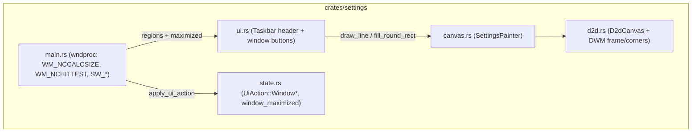

# Ayarlar Penceresi Entegre Üst Çubuk ve Başlık Sadeleştirme Implementation Plan

> **For agentic workers:** REQUIRED SUB-SKILL: Use superpowers:subagent-driven-development (recommended) or superpowers:executing-plans to implement this plan task-by-task. Steps use checkbox (`- [ ]`) syntax for tracking.

**Goal:** Remove the separate Windows titlebar strip on the Settings window (`crates/settings`) by integrating custom Direct2D window controls (`—`, `□`, `×`), drag/resize hit-testing, and `"Taskbar"` branding into the `#070708` canvas.

**Architecture:** `main.rs` keeps `WS_OVERLAPPEDWINDOW` for native animations, Aero Snap, and DWM shadow (`DwmExtendFrameIntoClientArea` + `DWMWA_WINDOW_CORNER_PREFERENCE`), strips the OS non-client frame via `WM_NCCALCSIZE`, and routes edge resize + caption drag via a pure `compute_nc_hit_test` helper called from `WM_NCHITTEST`. `SettingsPainter` / `D2dCanvas` gain `draw_line` for crisp vector window icons, `state.rs` adds window control `UiAction` variants and `window_maximized` state, and `ui.rs` renders the `"Taskbar"` title, shifted live-status pill, and top-right window controls in both splash and main phases.

**Architecture Diagram:**



**Tech Stack:** Rust 2024, `windows` crate (`0.62.2`), Direct2D, DWM (`DwmExtendFrameIntoClientArea`, `DWMWA_WINDOW_CORNER_PREFERENCE`).

**Spec:** [2026-11-16-settings-integrated-titlebar-design.md](file:///c:/Users/Mert/Documents/Taskbar/docs/superpowers/specs/2026-11-16-settings-integrated-titlebar-design.md)

## Global Constraints

- Preserve `WS_OVERLAPPEDWINDOW` window style with Windows 11 DWM rounded corners and shadow; do not fall back to a shadowless `WS_POPUP`.
- Window title in `main.rs` and main header text in `ui.rs` must both be `"Taskbar"`.
- Splash screen (`AppPhase::Splash`) must still expose draggable top area and working window buttons (`—`, `□`, `×`).
- `crates/core` and `crates/bar` must remain untouched.
- All hit regions (including at minimum window size `520x460`) must remain strictly within `0..size.w` and `0..size.h` with zero overlap between `"Taskbar"`, the live status pill, and the window buttons.

## Review Focus

- **Maximized window clipping:** When `IsZoomed(hwnd)` is true, `WM_NCCALCSIZE` receives expanded OS frame bounds; failing to clamp `params.rgrc[0]` to `MONITORINFO.rcWork` clips the top-right `×` button off-screen. Tested in Task 3 (`clamp_maximized_rect_to_work_area`).
- **Caption drag blocking clicks on status pill or window buttons:** `WM_NCHITTEST` returning `HTCAPTION` for the whole header row would swallow hover/clicks on `—`, `□`, `×` or status pill. Tested in Task 3 (`nc_hit_test_prefers_hit_regions_over_caption`).
- **Minimum window width (`520px`) overlap:** At `520x460`, `"Taskbar"` + subtitle + `● Canlı Önizleme` + 3 caption buttons could collide if X/Y coordinates aren't compact. Tested in Task 2 (`small_window_keeps_all_hit_regions_in_bounds` + `header_controls_do_not_overlap_at_min_width`).
- **Splash screen lock-out:** `handle_lbutton_down` previously returned early whenever `AppPhase::Splash` was active, which would prevent closing or minimizing during splash. Tested in Task 2 (`splash_phase_exposes_window_controls_only`) and Task 3 (`is_window_control_action`).
- **Non-maximized resize borders:** `WM_NCHITTEST` must return `HTLEFT`..`HTBOTTOMRIGHT` within `8px` borders when restored, and `HTCLIENT` (no resize borders) when maximized so edge clicks hit `×` at the screen corner cleanly. Tested in Task 3 (`nc_hit_test_borders_disabled_when_maximized`).

---

### Task 1: Add `draw_line` to `SettingsPainter` / `D2dCanvas` and `Window*` actions to `state.rs`

**Files:**
- Modify: [canvas.rs](file:///c:/Users/Mert/Documents/Taskbar/crates/settings/src/canvas.rs#L21-L23)
- Modify: [d2d.rs](file:///c:/Users/Mert/Documents/Taskbar/crates/settings/src/d2d.rs#L5-L38) and [d2d.rs](file:///c:/Users/Mert/Documents/Taskbar/crates/settings/src/d2d.rs#L164-L190)
- Modify: [state.rs](file:///c:/Users/Mert/Documents/Taskbar/crates/settings/src/state.rs#L14-L36), [state.rs](file:///c:/Users/Mert/Documents/Taskbar/crates/settings/src/state.rs#L93-L121), and [state.rs](file:///c:/Users/Mert/Documents/Taskbar/crates/settings/src/state.rs#L144-L280)

**Interfaces:**
- Produces in `crates/settings/src/canvas.rs`:
  - `SettingsPainter::draw_line(&mut self, _x1: f32, _y1: f32, _x2: f32, _y2: f32, _width: f32, _color: [u8; 4])`
- Produces in `crates/settings/src/d2d.rs`:
  - `pub fn apply_integrated_frame(hwnd: HWND)` (extends DWM frame `(0, 0, 1, 0)` and sets `DWMWA_WINDOW_CORNER_PREFERENCE = DWMWCP_ROUND` alongside dark mode)
  - `D2dCanvas::draw_line` implementation using `ID2D1HwndRenderTarget::DrawLine`
- Produces in `crates/settings/src/state.rs`:
  - `UiAction::WindowMinimize`, `UiAction::WindowMaximize`, `UiAction::WindowClose`
  - `pub window_maximized: bool` field on `SettingsAppState` (initialized `false`)

- [ ] **Step 1: Write failing unit tests in `crates/settings/src/state.rs`**

Add a test `window_control_actions_do_not_dirty_config` verifying `SettingsAppState::new` initializes `window_maximized == false` and applying `UiAction::WindowMinimize`, `UiAction::WindowMaximize`, `UiAction::WindowClose` returns `ActionEffect::None` without setting `has_unsaved_changes()`.

- [ ] **Step 2: Run test to verify it fails**

Run: `cargo test -p taskbar-settings window_control_actions_do_not_dirty_config`
Expected: FAIL with missing `WindowMinimize` / `window_maximized`.

- [ ] **Step 3: Implement `draw_line`, `apply_integrated_frame`, and `state.rs` additions**

1. In [canvas.rs](file:///c:/Users/Mert/Documents/Taskbar/crates/settings/src/canvas.rs#L21-L23), add `fn draw_line(&mut self, _x1: f32, _y1: f32, _x2: f32, _y2: f32, _width: f32, _color: [u8; 4]) {}` to `SettingsPainter`.
2. In [d2d.rs](file:///c:/Users/Mert/Documents/Taskbar/crates/settings/src/d2d.rs):
   - Import `D2D_POINT_2F` from `Direct2D::Common`, `DwmExtendFrameIntoClientArea`, `DWMWA_WINDOW_CORNER_PREFERENCE`, `DWMWCP_ROUND`, `DWM_WINDOW_CORNER_PREFERENCE` from `Dwm`, and `MARGINS` from `UI::Controls`.
   - Rename/replace `apply_dark_titlebar(hwnd)` with `pub fn apply_integrated_frame(hwnd: HWND)` (or keep `apply_dark_titlebar` calling it if needed, or update `main.rs` call site) setting `DWMWA_USE_IMMERSIVE_DARK_MODE = 1`, `DWMWA_WINDOW_CORNER_PREFERENCE = DWMWCP_ROUND`, and `DwmExtendFrameIntoClientArea(hwnd, &MARGINS { cxLeftWidth: 0, cxRightWidth: 0, cyTopHeight: 1, cyBottomHeight: 0 })`.
   - Implement `SettingsPainter::draw_line` on `D2dCanvas` using `self.target.DrawLine`.
3. In [state.rs](file:///c:/Users/Mert/Documents/Taskbar/crates/settings/src/state.rs):
   - Add `WindowMinimize`, `WindowMaximize`, `WindowClose` to `UiAction`.
   - Add `pub window_maximized: bool` to `SettingsAppState` (default `false` in `new`).
   - Return `ActionEffect::None` for `UiAction::WindowMinimize | UiAction::WindowMaximize | UiAction::WindowClose` in `apply_action`.

- [ ] **Step 4: Run tests to verify pass**

Run: `cargo test -p taskbar-settings`
Expected: PASS.

- [ ] **Step 5: Commit**

```bash
git add crates/settings/src/canvas.rs crates/settings/src/d2d.rs crates/settings/src/state.rs
git commit -m "feat(settings): add vector line painter, integrated DWM frame, and window actions"
```

---

### Task 2: Render `"Taskbar"` header, shifted status pill, and vector window controls in `ui.rs`

**Files:**
- Modify: [ui.rs](file:///c:/Users/Mert/Documents/Taskbar/crates/settings/src/ui.rs#L1053-L1200) and tests in [ui.rs](file:///c:/Users/Mert/Documents/Taskbar/crates/settings/src/ui.rs#L1405-L1598)

**Interfaces:**
- Consumes: `SettingsPainter::draw_line`, `UiAction::WindowMinimize`, `UiAction::WindowMaximize`, `UiAction::WindowClose`, `SettingsAppState::window_maximized`
- Produces in `crates/settings/src/ui.rs`:
  - `pub const TITLEBAR_DRAG_HEIGHT: i32 = 64;`
  - Window control buttons drawn at top-right (`y = 0`, `h = 34`, `w = 42` each: `win_minimize`, `win_maximize`, `win_close`) in both `render_splash_screen` and `render_settings_ui_animated`.
  - Close button uses `COLOR_CLOSE_HOVER = [232, 17, 35, 255]` (`#E81123`) hover fill and `[196, 16, 30, 255]` press fill.
  - Header title text changed from `"Taskbar Ayarları"` to `"Taskbar"`.
  - Status pill positioned at `x = w - 126 - 12 - 152`, `y = 10`, `w = 152`, `h = 26` so it never overlaps `"Taskbar"` (`x: 20..120`), subtitle (`y: 44`), or window controls (`x: w - 126..w`).

- [ ] **Step 1: Write failing tests in `crates/settings/src/ui.rs`**

Update `RecordingCanvas` in `ui.rs` to also record `lines: Vec<(f32, f32, f32, f32)>` in `impl SettingsPainter for RecordingCanvas`, update the existing assertion in `render_settings_ui_produces_hit_regions_for_all_tabs_and_controls` from `"Taskbar Ayarları"` to `"Taskbar"` (and assert `"Taskbar Ayarları"` is NOT rendered), update `splash_phase_renders_wordmark_and_blocks_main_hit_regions` to assert only window-control `HitRegion`s are present (zero tab/config actions), and add:
1. `splash_phase_exposes_window_controls_only`: verifies `render_settings_ui_animated` in `AppPhase::Splash` returns exactly 3 `HitRegion`s (`WindowMinimize`, `WindowMaximize`, `WindowClose`).
2. `header_controls_do_not_overlap_at_min_width`: renders at `Size { w: 520, h: 460 }`, checks all 3 window control `HitRegion`s are strictly right of `x = 390`, inside bounds, and checks `draw_line` was called for their vector icons (including restore overlapping-box lines when `state.window_maximized = true`).

- [ ] **Step 2: Run tests to verify they fail**

Run: `cargo test -p taskbar-settings ui::tests`
Expected: FAIL (`"Taskbar Ayarları"` still present, splash returns empty regions, no `win_*` hit regions).

- [ ] **Step 3: Implement `draw_window_controls` and updated header in `crates/settings/src/ui.rs`**

1. Add `pub const TITLEBAR_DRAG_HEIGHT: i32 = 64;` and helper `draw_window_controls(canvas, regions, anim, w, maximized, alpha)` drawing:
   - `win_minimize` (`Rect { x: w - 126, y: 0, w: 42, h: 34 }`, `UiAction::WindowMinimize`) with a horizontal `10px` line centered inside.
   - `win_maximize` (`Rect { x: w - 84, y: 0, w: 42, h: 34 }`, `UiAction::WindowMaximize`) with a `9x9` square outline when `!maximized` or overlapping restore squares when `maximized`.
   - `win_close` (`Rect { x: w - 42, y: 0, w: 42, h: 34 }`, `UiAction::WindowClose`) with two `9px` diagonal `X` lines and `#E81123` hover background.
   Note: use `anim.hover_amount(id)` / `anim.press_amount(id)` for smooth color transitions matching the rest of the UI.
2. Update `render_splash_screen` to accept `regions: &mut Vec<HitRegion>` and `maximized: bool` and call `draw_window_controls` (with `alpha = 1.0`).
3. In `render_settings_ui_animated`:
   - Change `"Taskbar Ayarları"` to `"Taskbar"`.
   - Move `status_pill` to `Rect { x: w - 290, y: 10, w: 152, h: 26 }` (with radius `13.0`).
   - Call `draw_window_controls(canvas, &mut regions, anim, w, state.window_maximized, alpha)`.

- [ ] **Step 4: Run tests to verify pass**

Run: `cargo test -p taskbar-settings ui::tests`
Expected: PASS.

- [ ] **Step 5: Commit**

```bash
git add crates/settings/src/ui.rs
git commit -m "feat(settings): integrate custom window controls and rename header to Taskbar"
```

---

### Task 3: Wire borderless `WM_NCCALCSIZE`, `WM_NCHITTEST`, window title `"Taskbar"`, and window control actions in `main.rs`

**Files:**
- Modify: [main.rs](file:///c:/Users/Mert/Documents/Taskbar/crates/settings/src/main.rs#L10-L495)

**Interfaces:**
- Consumes: `crate::d2d::apply_integrated_frame`, `crate::ui::TITLEBAR_DRAG_HEIGHT`, `UiAction::WindowMinimize`, `UiAction::WindowMaximize`, `UiAction::WindowClose`, `SettingsAppState::window_maximized`
- Produces in `crates/settings/src/main.rs`:
  - `pub fn is_window_control_action(action: &UiAction) -> bool`
  - `pub fn clamp_maximized_rect_to_work_area(rect: &mut RECT, work: RECT)`
  - `pub fn compute_nc_hit_test(client_x: i32, client_y: i32, client_w: i32, client_h: i32, is_maximized: bool, regions: &[HitRegion]) -> u32`

- [ ] **Step 1: Write failing unit tests in `crates/settings/src/main.rs`**

Add tests:
1. `is_window_control_action_identifies_caption_actions`: true for `WindowMinimize`/`WindowMaximize`/`WindowClose`, false for `Save`/`SelectTab`.
2. `clamp_maximized_rect_to_work_area_prevents_offscreen_overflow`: verifies an oversized `RECT { left: -8, top: -8, right: 1928, bottom: 1048 }` clamps to `work = RECT { left: 0, top: 0, right: 1920, bottom: 1040 }`.
3. `nc_hit_test_borders_disabled_when_maximized`: `(2, 2)` returns `HTTOPLEFT` when `!is_maximized` and `HTCLIENT` when `is_maximized` (so a `HitRegion` at top-right `×` isn't overridden by resize border).
4. `nc_hit_test_prefers_hit_regions_over_caption`: given a `HitRegion` at `(394, 0, 42, 34)`, `(410, 16)` inside `TITLEBAR_DRAG_HEIGHT` returns `HTCLIENT`, while `(150, 16)` outside any `HitRegion` returns `HTCAPTION`, and `(150, 120)` returns `HTCLIENT`.

- [ ] **Step 2: Run tests to verify they fail**

Run: `cargo test -p taskbar-settings --bin taskbar-settings tests::`
Expected: FAIL with missing functions.

- [ ] **Step 3: Implement `WM_NCCALCSIZE`, `WM_NCHITTEST`, `"Taskbar"` title, and window button actions in `main.rs`**

1. Update `CreateWindowExW` window title on line 437 from `w!("Taskbar Ayarları")` to `w!("Taskbar")`.
2. In `WM_CREATE`, call `apply_integrated_frame(hwnd)`. After `CreateWindowExW`, call `SetWindowPos(hwnd, None, 0, 0, 0, 0, SWP_NOMOVE | SWP_NOSIZE | SWP_NOZORDER | SWP_FRAMECHANGED)` so the frame recalculates before showing.
3. Implement `WM_NCCALCSIZE`: when `wp.0 != 0`, if `IsZoomed(hwnd).as_bool()`, get `MONITORINFO` via `MonitorFromWindow(hwnd, MONITOR_DEFAULTTONEAREST)` + `GetMonitorInfoW` and call `clamp_maximized_rect_to_work_area(&mut params.rgrc[0], mi.rcWork)`, then return `LRESULT(0)`.
4. Implement `WM_NCHITTEST`: convert screen `(x, y)` with `ScreenToClient`, read `GetClientRect`, check `IsZoomed(hwnd).as_bool()`, and return `LRESULT(HIT_REGIONS.with(|hr| compute_nc_hit_test(pt.x, pt.y, rc.right - rc.left, rc.bottom - rc.top, is_max, &hr.borrow())) as isize)`.
5. In `WM_SIZE`, update `STATE` `window_maximized = wp.0 == SIZE_MAXIMIZED as usize`.
6. In `handle_lbutton_down`: when `in_splash` is true, still hit-test `HIT_REGIONS` and proceed ONLY if `is_window_control_action(&region.action)`.
7. In `apply_ui_action`: handle `UiAction::WindowMinimize` (`ShowWindow(hwnd, SW_MINIMIZE)`), `UiAction::WindowMaximize` (`ShowWindow(hwnd, if IsZoomed(hwnd).as_bool() { SW_RESTORE } else { SW_MAXIMIZE })`), and `UiAction::WindowClose` (`PostMessageW(Some(hwnd), WM_CLOSE, WPARAM(0), LPARAM(0))`) and return early after invalidating if needed.

- [ ] **Step 4: Run full test suite & check build**

Run: `cargo test --workspace`
Expected: All tests in `core`, `bar`, `settings`, `updater` PASS with zero compiler warnings.

- [ ] **Step 5: Commit**

```bash
git add crates/settings/src/main.rs
git commit -m "feat(settings): wire borderless WM_NCCALCSIZE/WM_NCHITTEST and Taskbar title"
```
